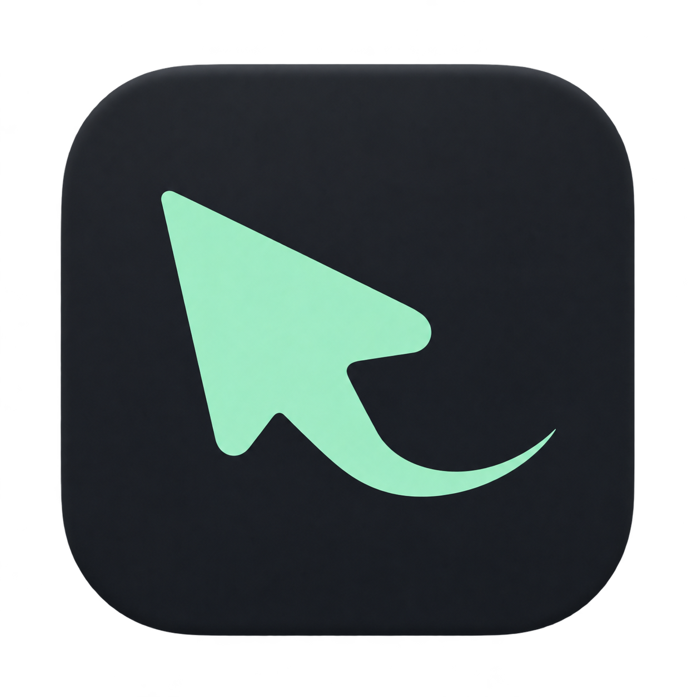

<h1 align="center"> Auto Recorder</h1>

## 🤖 Install with an agent

Copy this to **Codex or an agent that can operate your Mac**:

```text
Please install the latest official stable release of Auto Recorder:
https://github.com/Endless1936/auto-recorder/releases/latest

Check that this Mac uses Apple Silicon and macOS 15+; explain and stop if
unsupported. Download the matching official DMG, verify its checksum entry and the
app's code signature, then install into /Applications or ~/Applications if needed.
Check that any existing same-named app belongs to this project; if already up to
date, check it and open it. Before updating, ask me to quit; preserve recordings,
projects and settings. The app is signed but not notarized: guide me to confirm Open
Anyway and screen/microphone permissions myself, without disabling security,
removing quarantine or installing developer tools. Report the version and
installation path. If you cannot operate this Mac, say so honestly.
```

## 🎬 Made for demonstrations

Auto Recorder is a local Mac screen recorder for AI tool demos, software tutorials, and product walkthroughs. It automatically zooms in as you work, then lets you make simple cuts and adjust the framing.

## ✨ Highlights

- 🖥️ **Flexible capture** — Record a screen, a window, or a selected area. Your last confirmed area is remembered.
- 🎯 **Automatic focus** — Zoom in on a click, follow the cursor, and smoothly return to full view after inactivity.
- ✂️ **Simple editing** — Split, trim, delete, and rearrange clips on the timeline. Adjust the zoom curve and framing.
- 🎙️ **Audio control** — Independently toggle system audio and microphone input. Pause and resume from the menu bar.
- 📁 **Editable projects** — Keep the original recording and project in a local folder, reopen it to edit, and export when ready.
- 🎞️ **Quality options** — Record in HEVC or ProRes 422 at 30 or 60 fps.

## 🚀 Get started

1. Choose a screen, window, or area and your audio sources, then start recording.
2. Stop when finished and adjust clips or framing in the editor.
3. Export your video or keep the project for later.

## 🍎 Manual installation

Requires Apple Silicon (M1 or later) and macOS 15 or later. The app interface is in Chinese.

Download [Auto Recorder 2.4.3](https://github.com/Endless1936/auto-recorder/releases/download/v2.4.3/Auto-Recorder-v2.4.3-macos-arm64.dmg), open the DMG, and drag the app into Applications. If first launch is blocked, use System Settings → Privacy & Security → Open Anyway, then grant screen-recording access.

📖 [Usage (Chinese)](docs/USAGE.md) · [Contributing](CONTRIBUTING.md) · [GPL-3.0-only](LICENSE) · [中文](README.md)
