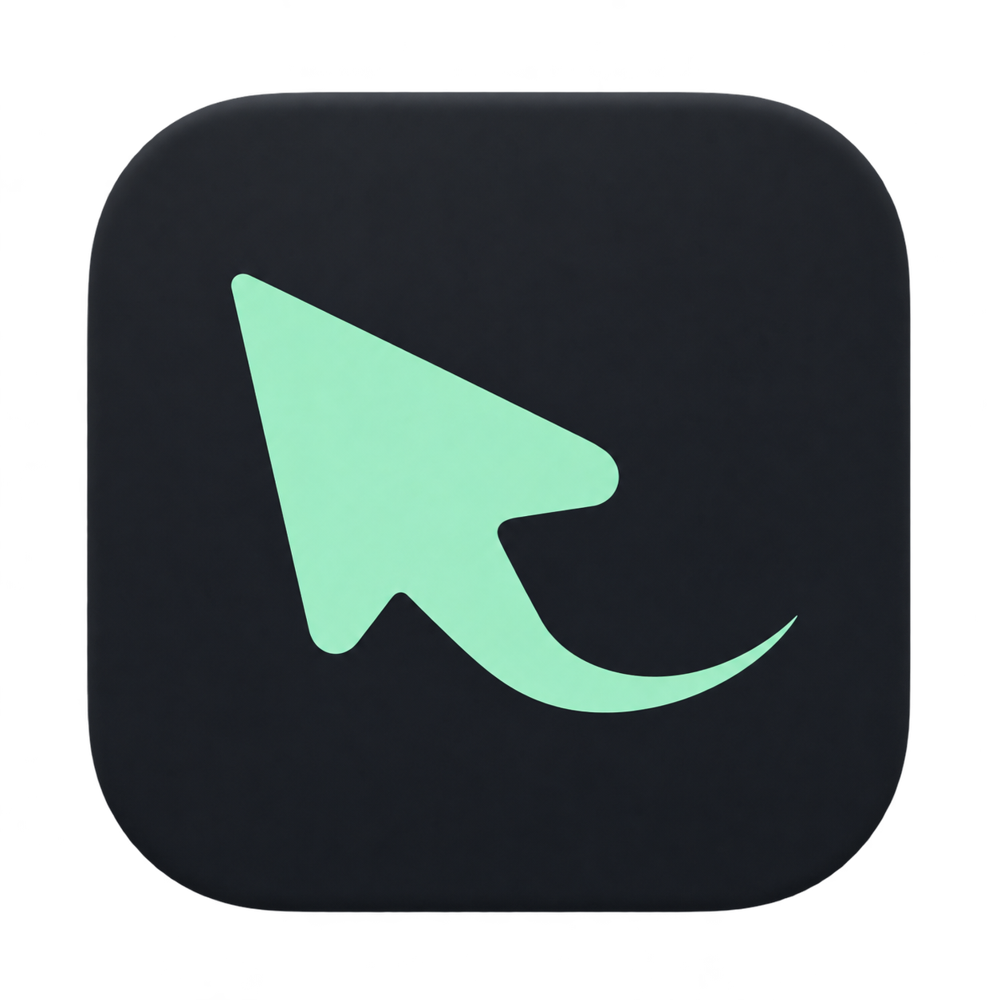

<h1 align="center"> Auto Recorder</h1>

🎬 本地录屏，自动放大，轻松剪切。

🖥️ 录制屏幕、窗口或选区　·　🎯 跟随鼠标聚焦　·　✂️ 剪切并导出

### 🚀 安装

复制这段给 **Codex 或能操作本机的 Agent**：

```text
请帮我安装 Auto Recorder 官方最新稳定版：
https://github.com/Endless1936/auto-recorder/releases/latest

先检查这台 Mac 是 Apple Silicon 且运行 macOS 15+，不满足就说明并停止。
从官方 Release 下载对应 DMG，核对安装包对应的 SHA256 和应用签名。
安装到 /Applications；无权限则用 ~/Applications。
已有安装先确认属于本项目，最新版检查后直接打开。
更新前让我退出应用，保留录屏、工程和设置。
本应用已签名但未公证，遇到“仍要打开”或录屏／麦克风授权时引导我确认。
不关闭安全检查、不移除隔离属性，也不安装开发环境。
完成后告知版本和路径；没有操作本机的能力时请如实说明。
```

[手动下载 v2.4.3](https://github.com/Endless1936/auto-recorder/releases/download/v2.4.3/Auto-Recorder-v2.4.3-macos-arm64.dmg) · [English](README.en.md)

🍎 适用 M1 及更新芯片、macOS 15+，界面为中文。

手动安装：将 App 拖入“应用程序”。若首次被拦截，到“系统设置 → 隐私与安全性 → 仍要打开”，再按提示授权录屏。

📖 [使用说明](docs/USAGE.md) · [开发与贡献](CONTRIBUTING.md) · [GPL-3.0-only](LICENSE)
